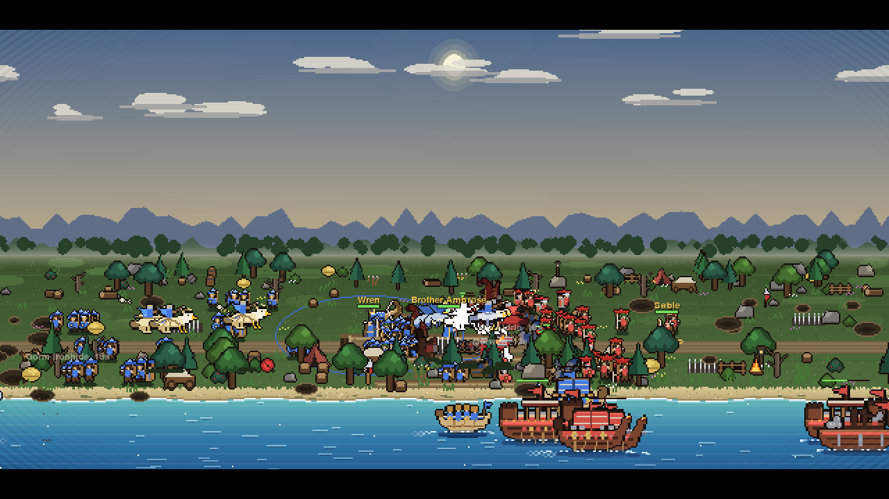
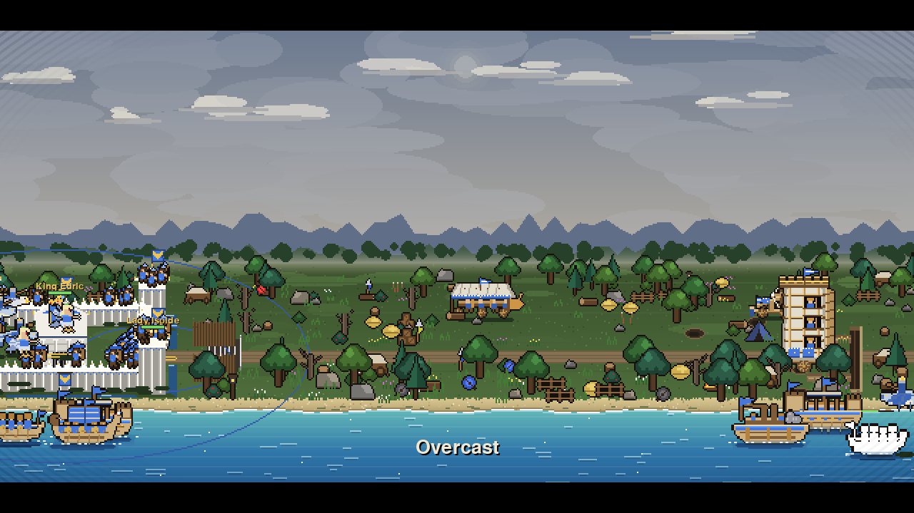
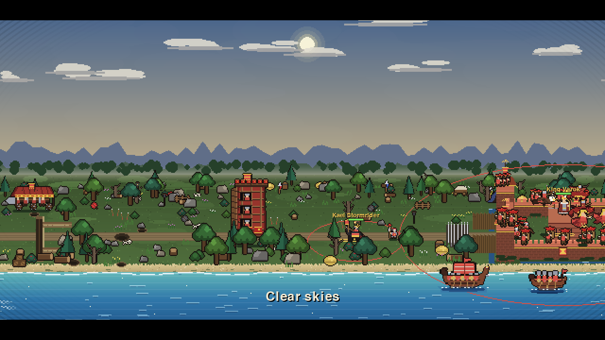
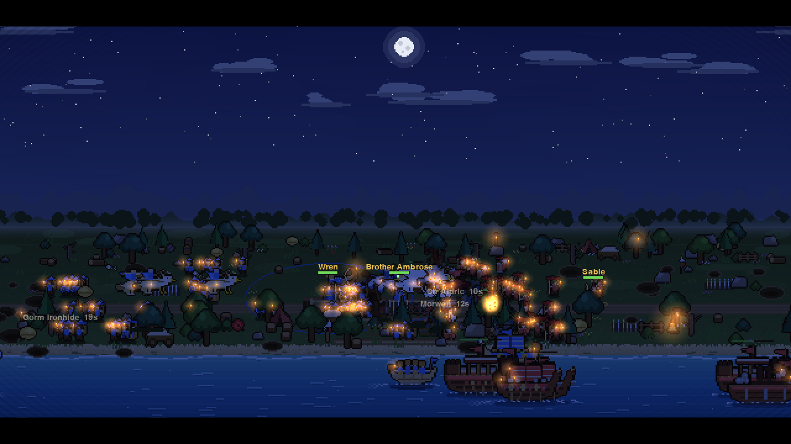
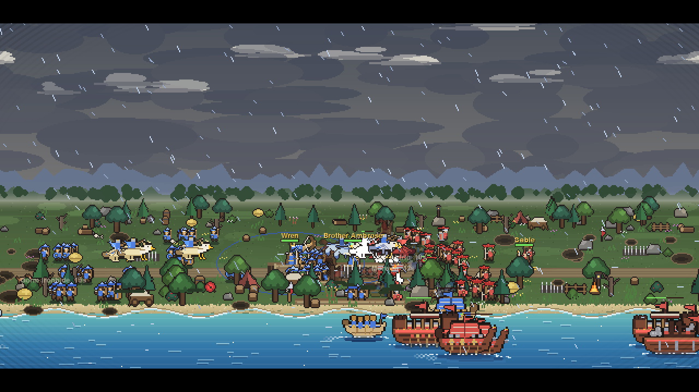

# Pixel BS



<table>
  <tr>
    <td></td>
    <td></td>
  </tr>
  <tr>
    <td></td>
    <td></td>
  </tr>
</table>

*Day, night and weather over the same war. These are real frames from the game; `python docs/capture.py` regenerates
them.*

A castle-war simulator in pygame-ce. Two castles face each other across a valley: **Ravensmere** (blue, left) and
**Ironvale** (red, right). Each has walls, corner towers, archers on the walls, a gate, a moat and a keep with a king
on it. Along the bottom of the map lies a beach and a sea, where ships fight and land marines. Nothing ends: the
fighting goes on for as long as the program runs, with both sides mustering reinforcements as they lose men. It is built
as a pastime or wallpaper: no timer, no end, no input needed.

The view is a side-on 2.5D one. The battlefield's depth becomes lanes: the far edge is small and high on screen, the
near edge large and low. The field is 4000 pixels wide (the window shows 1280) and a camera scrolls over it, following
the fighting on its own; the arrow keys pan it by hand. Hills, trees and the sea scroll at different speeds for depth
(X turns that off). A day and night cycle (five real minutes) tints the scene; at night the men carry torches, castles
glow and stars and a moon come out. Weather comes and goes and changes how the fighting goes. Everything is drawn at
low resolution (640x360) and scaled up, so it has a pixel-art feel. The program starts fullscreen with cinematic bars
and no HUD.

## What is on the field

**Troops** (both sides field all of them; `scenarios/castle_war.json`):

| Unit | Role |
| --- | --- |
| spearman | the line infantry |
| bowman | archer: shoots arrow showers into packed crowds |
| fire archer | sets its target alight |
| knight | mounted: lances hit foot soldiers hard when charging in pairs |
| longbowman | long-reach, fragile archer |
| halberdier | pole-arm infantry: hits mounted men 1.8 times as hard |
| berserker | fast and fragile, hits harder the more hurt it is |
| pavise crossbowman | a crossbow behind a big shield: its bolts pierce the testudo shield wall |
| war dog | very fast, and hunts routing men |
| marine | lands from the boats; plain infantry |
| tower bowman | a garrison archer that stands on walls and towers |

**Siege engines** (they march with the army and batter walls, gates, towers and palisades):

| Engine | Role |
| --- | --- |
| catapult | stones with splash, sometimes burning pitch |
| trebuchet | a high lob with a long reach and big splash |
| mangonel | a lighter engine that always throws pitch |
| battering ram | hits structures only, never men |
| ballista | shoots only at the sky: a heavy bolt that ignores the flyer dodge |

**Flyers**: wyvern riders bomb the ground with pitch; hawk riders hunt other flyers; griffon riders are heavy air
fighters; harpies swoop on men and rake them rather than bombing. See *Flyers* below.

**Ships**: longship, galley, catapult ship and landing boat. See *The sea* below.

**Heroes and kings**: four named heroes per side plus a king on each keep. See *Heroes*.

## Waves and sorties

- **Musters**: every 20 s both sides get 6 spearmen, 3 bowmen and a fire archer in their courtyards, while each side has
  fewer than 130 units. Each firing is a **wave**.
- **Siege waves**: every fifth muster, each side gets a catapult, trebuchet, mangonel, ballista and battering ram (the
  `siege_wave` event, which uses the `wave` condition). Catapults, mangonels and ballistae also arrive on timers (from
  40 s), and trebuchets from 150 s.
- **Sorties**: when 6 enemies gather in front of a gate, or 10 of a side's men are in its courtyard, the gate opens and
  a sortie goes out. Every sortie carries every land unit type: bowmen, spearmen, fire archers, knights, longbowmen,
  halberdiers, berserkers, war dogs and pavise crossbowmen. The gate shuts again 20 s later.
- **Assaults**: once 25 of a side's units are in the middle, or after 150 s, that side's goal changes to the enemy keep
  and it marches on it. This fires once per battle.
- **Air waves** every 40 s (wyverns, hawks, griffons, harpies, up to each type's `max_alive`) and **sea waves** every
  55 s (ships).

## The sea

The map's `"shore"` is the y where the beach gives way to water; everything from there down is a sea lane. Land troops
cannot enter the water and ships cannot leave it (`naval.py`).

| Ship | What it does |
| --- | --- |
| longship | a raider that rams other ships |
| galley | archers on a broad deck: shoots ships and men on the beach |
| catapult ship | throws stones at ships and the shore, with splash |
| landing boat | carries 6 marines to the enemy's beach, puts them ashore, goes home and reloads (50 s) |

Ships steer like flyers: they turn slowly, sweep in curves, circle their prey and keep station at the range of their
weapons. With nothing to fight they patrol from their own end of the sea to the enemy's and back. Land archers, siege
engines, heroes and flyers carrying fire can hit ships; melee troops cannot. Ships bob on the swell, leave a wake, burn
when hit and sink with a splash, leaving floating wreckage. Shots that miss throw up water.

## Weather

`weather.py` runs the weather in the simulation: clear, cloudy, rain, storm, fog and snow, changing every 60 to 130
seconds. The scenario's `"weather"` block sets the `start`, the `cycle` and the `weights`; W steps to the next kind.
Numbers ease from one state to the next over 14 s, so a front rolls in.

| Weather | Effect |
| --- | --- |
| rain | men walk slower, fire arrows mostly fail, burning men go out, arrows fly a little short |
| storm | all of that, plus wind that slows flyers, a rough sea that slows ships, and lightning that hurts and ignites |
| fog | men see less far |
| snow | men walk slower and see less far, and snow settles on the field |

It draws as grey and darkened skies, drifting cloud decks, rain with splashes, snow, banks of mist, lightning flashes
and thunder that arrives after them. Weather has its own random generator, so it never disturbs the fighting's dice.

## Heroes

Each castle has four named heroes of different kinds. Each has two **passive** skills (always on) and two **active**
skills (cast on their own judgement, then on cooldown). A hero who falls returns `respawn` seconds later (30). Heroes
never rout, rally the men near them, and a badly wounded melee hero pulls back to recover. Each shows a name, a health
bar and two lamps (lit when an active skill is ready); a faint ring on the ground shows the reach of an aura, and the
skill's name floats up when it is cast. Skills are listed in `heroes.py`; a hero is a unit type with `"hero": true` and
a `"skills"` list of four ids (two passive, two active), placed with a named group of one.

| Hero | Kind | Passive | Active |
| --- | --- | --- | --- |
| Sir Aldric the Unbroken (Ravensmere) | shield champion | Bulwark, Thornmail | Shield Wall, Earthshaker |
| Lady Isolde of the Lance | mounted commander | Raven Standard, Inspiring Presence | Lance Charge, Rally Horn |
| Wren the Sharpshooter | ranger | Eagle Eye, Deadeye | Rain of Arrows, Piercing Shot |
| Brother Ambrose the Healer | priest | Benediction, Sanctified | Mending Light, Holy Fire |
| Gorm Ironhide the Berserker (Ironvale) | axe champion | Bloodlust, Rage | Whirlwind, Battle Roar |
| Kael Stormrider, Warlord | mounted commander | Swiftness, Warband | Thunder Charge, Cavalry Rally |
| Sable the Fire-Archer | fire ranger | Pitch Arrows, Hunter's Eye | Inferno, Cripple Shot |
| Morwen the Hexwitch | siege witch | Siegecraft, Dark Pact | Hex, Meteor |

Each side's **king** stands on top of his keep (King Edric the Steadfast, King Varok the Tyrant): a crowned hero who
cannot leave the keep, shoots foes within 220, and has two auras and two commands that reach across the field (Royal
Command, Last Stand / War Banner, Royal Volley). He returns 60 s after falling. For show he strolls about the keep roof
and now and then cheers with a hop.

## Two sides, two looks

Each side has a `"style"` and its own versions of the common troops, flyers, ships and siege engines: a unit type with
`"side"` and `"replaces"` takes the place of that unit whenever the side spawns it. **Ravensmere is Greek**
(`ravensmere`: hoplites, hippeis, triremes, Pegasus-like gryphs and sirens) and **Ironvale is a Roman legion**
(`ironvale`: legionaries, sagittarii, equites, onagers, quinqueremes). The style sets the look:

| | Ravensmere (Greek) | Ironvale (Roman) |
| --- | --- | --- |
| castle | white marble with fluted columns and a meander frieze, gabled antefix battlements, temple-pediment tower roofs and keep, gold acroteria | red brick in a running bond with a gilt string course, plain crenellations, terracotta turret roofs, a keep with two legion standards (aquila) |
| men | bronze armour and a tall blue horsehair crest | legionary iron and a scarlet transverse crest |
| flyers | white, blue and gold, laurel wreaths and gilded diadems | scarlet, brown and gold, aquila crests |
| ships | pale oak, a painted eye on the bow, bronze ram, round shields on the rail | dark oak, iron ram, scarlet scuta with gold bosses along the rail |
| engines | pale olive wood, bronze fittings, blue meander-edged shields, a bronze krios ram head | dark oak, iron, scarlet hides and scuta, vexillum banners, a scarlet-collared iron ram |

Unit names follow the themes (Hoplite, Hippeis, Drakon, Owl of Athena, Trireme, Epibates / Legionary, Sagittarius, Eques,
Onager, Turris, Draco, Aquilifer, Quinquereme, Liburna, Classiarius).

The siege engines (`siege_art.py`) are drawn large, about twice the height of a soldier.

## Siege tower

A siege tower (Ravensmere) or war tower (Ironvale) is a slow, tough walking tower with archers inside (`"tower": true`,
`"garrison"`, `"shoot_height"`). It looses a volley of two or three arrows from the top and its slits, more while it is
full; its archers die with it as it takes damage, and when it falls the survivors tumble out as bowmen.

## Flyers

Flyers ignore walls, moats and trenches and are out of reach of melee men, siege engines and splash. Archers, the
kings, ballistae and the ranged heroes can shoot them down, though a share of the arrows miss (`AIR_DODGE`). A flyer
steers rather than walks, so it makes curving bombing runs past its target and circles back; hawks and griffons wheel
round each other in dogfights. Shot-down flyers fall burning out of the sky. Storms slow flyers and push them with the
wind. In a scenario a flyer is a unit type with `"flying": true`, an `"air_role"` (`"ground"` or `"air"`) and an
`"altitude"`. A ground flyer with `"swoop": true` (the harpy) rakes men instead of bombing.

## Sound, shots and camera

- **Sound** (`sound.py`) is synthesized with numpy at start-up, so there are no audio files: a slow modal war march
  loops under a faint wind, with effects for bows, flaming arrows, arrow showers, hits, catapult and trebuchet launches,
  impacts, sword clashes, gates, breaches, horns, splashes, thunder and lightning cracks, and loops of rain, surf and
  gale wind that follow the weather. Effects are panned and fade with distance. Volumes and mute are saved in
  `audio_settings.json`. Put your own `.ogg`/`.mp3`/`.wav` in a `music/` folder to play it instead of the march. With
  no audio device the game runs silent.
- **Shots** all fly real arcs from the shooter to where they land. Flight time follows the battle speed. A stone
  throws up dust, debris and a shock ring; burning pitch bursts into flame and leaves a fire. At sea a miss throws up a
  splash and a hit throws wood.
- **Camera** glides on a damped spring chasing a smoothed point (`CAM_SMOOTH_TIME`, `CAM_MAX_SPEED`, `CAM_AIM_SMOOTH`
  in `config.py`); arrow-key panning eases in and out.

## Running it

Requires Python 3, pygame-ce (built against 2.5.7), numpy and scipy:

```bash
pip install pygame-ce==2.5.7 numpy scipy
python main.py                          # the castle war
python main.py scenarios/other.json     # any other scenario file
```

| Key | Does |
| --- | --- |
| SPACE | pause / resume |
| + / - | faster / slower (1x, 4x, 16x, 64x) |
| LEFT / RIGHT | pan the camera (it goes back to following the fighting after 8 seconds) |
| C | turn the following camera on or off |
| X | turn the parallax (layers scrolling at different speeds) on or off |
| W | step to the next weather (clear, cloudy, rain, storm, fog, snow) |
| M | mute / unmute all sound |
| [ / ] | music volume down / up |
| , / . | effects volume down / up |
| H | show or hide the HUD (hidden by default; it shows the weather too) |
| L | show or hide the cinematic bars |
| F11 | fullscreen on or off |
| R | start a fresh battle now (with a new seed) |
| ESC | quit |

## Headless check

```bash
python check.py                       # runs seeds 1 and 2 for 420 battle seconds each and prints each one
python check.py --seeds 1,5,9         # other seeds
python check.py --frame castle.png    # also save a frame of the first battle to a PNG
python check.py --frame f.png --cam 3300 --phase 0.0   # ...with the camera at world x 3300, at night
```

`check.py` sets SDL to its dummy video and audio drivers, so no window opens. It checks that a broken scenario is
rejected with a readable message; runs each seed for 420 battle seconds; checks the rules (both sides muster, troops keep
fighting, a gate sallies, ambushes spring, heroes cast every skill and return after falling, flyers bomb, dogfight, fall
and swoop, ballistae loose bolts, the garrison shoots from the walls, ships fight and land marines, the weather
changes); draws dusk, night and dawn frames; and times frames at 4x speed against the 30 fps budget. It exits with
status 1 if a check fails.

## Files

| File | What it is |
| --- | --- |
| `main.py` | the window and the controls: one battle that runs on, and R to start a fresh one |
| `battle.py` | the battle engine: movement, fighting, morale, projectiles, events, objectives (no pygame in it) |
| `air.py`, `heroes.py` | flyers and hero skills (mixins for the engine) |
| `naval.py`, `weather.py` | ships and weather (mixins for the engine) |
| `scenario.py` | loads a scenario JSON file and checks it |
| `render.py` | the side-on 2.5D drawing: camera, day and night, lights, blocks, units, shots, HUD |
| `render_sea.py`, `render_weather.py` | drawing the sea and ships, and the sky, rain, snow, fog and lightning (mixins) |
| `siege_art.py` | the large siege engines and the siege tower, in both side styles |
| `sprites.py` | the unit art: character-art sprites with outlines |
| `doodads.py`, `scenery.py` | scenery props, and where they go and which can hide a man |
| `sound.py` | the synthesized music, effects and weather loops |
| `config.py` | how the engine behaves (speeds, morale rules, sea and weather numbers, the look) |
| `scenarios/castle_war.json` | Ravensmere against Ironvale |
| `check.py` | the headless check |

## How a battle works

Time runs in ticks: 2 per second of battle time at 1x (`SIM_RATE`). Each tick:

- Every unit with no target within sight walks toward its side's **goal** (at first the middle of the valley). Each
  side has a flow field, so units go round walls when the way round is short and otherwise press up against them.
  Land units are kept off the beach's edge and out of the water.
- A unit that sees an enemy walks straight at it if nothing solid is in the way, and attacks once the enemy is within
  its **reach**. Each hit does `attack` scaled by a random 0.6 to 1.4, reduced by the target's `defence`. Melee hits
  land at once.
- **Projectiles**: archers, siege engines and ships loose a projectile that hurts its target when it lands, after
  `ARROW_SIM_TIME` (0.5 s) or `STONE_SIM_TIME` (1.0 s) of battle time. If the shooter or the target has died by then,
  it fizzles. Each flies at its unit type's `angle` in degrees (45 by default; the trebuchet uses 75, a high lob).
- **Morale**: damage lowers morale; when a unit dies, friends within 90 pixels lose some and enemies gain a little. A
  unit whose morale drops below its `rout_at` routs, running away at 1.5 times its speed until it leaves the map or 30 s
  pass.
- **Siege engines** (`"siege": true`) batter the nearest enemy wall, gate, tower or palisade when no enemy unit is in
  sight. Each hit takes its `attack` off the structure's `hp`, and a structure at 0 hp is breached. `"splash"` also
  hurts men near the target. A `"struct_only"` unit (the ram) hits structures and never men.
- **Garrisons** (`"speed": 0`) stand on top of walls and towers at that height and shoot over them; if the block is
  breached they fall.
- **Moats** are solid water drawn as water; the gap in each castle's moat is the bridge.
- **Lanes**: each mobile unit keeps to one of four lanes, spread across the field and narrowing to the gate lanes before
  a gate, so a sortie comes out spread across the gate.
- **Tactics**:
  - *Archers kite*: a bowman closer than 45% of its reach to a foe steps back instead of shooting.
  - *Focus*: a unit attacks the nearby enemy that is near and hurt, so blows finish men off.
  - *Withdrawal*: a melee unit below morale 40 with more foes than friends nearby falls back.
  - *Testudo*: foot soldiers with 4 or more enemy archers within 150 and no foe in their face lock shields overhead and
    take 30% of arrow damage but move at half speed. Pavise crossbow bolts pierce it (`"pierce_shield"`).
  - *Spear formation*: mounted units with two or more mounted friends beside them level their lances and hit foot
    soldiers 1.6 times as hard. `"anti_mounted"` units (halberdiers) hit horsemen 1.8 times as hard.
  - *Berserk*: a `"berserk"` unit hits harder the more hurt it is (up to `BERSERK_SCALE`).
  - *Arrow showers*: archers with `"volley": true` loose a shower when 5 or more enemies are packed within 35 pixels.
  - *Flaming arrows*: `"fire": true` units set their target alight for 4 s (4 damage a second). Rain mostly stops this.
  - *Spikes*: terrain with `"style": "spikes"` wounds anyone on the ground in it.
  - *Hunting*: `"hunts_routers"` units (war dogs) chase men who are running away.
- **Trenches and craters** are cover: a man in one takes 45% of arrow damage, and archers step into cover between shots.
- **Ambushes**: every 8 seconds each side looks at where the enemy army is heading and, if a tree, bush, boulder,
  haystack, wagon or tent lies ahead (out of sight), hides a squad of up to 8 non-mounted men there. A hidden man cannot
  be seen or targeted. When a foe comes within 70 pixels the squad springs and strikes 1.6 times as hard for 6 s.
- **Positional play**: a melee blow from behind does 1.4 times the damage, and cavalry ride round a foot foe to strike
  from behind.

Nothing in the castle war has a time limit, timeout or victory condition; a keep can be reached, but nothing is decided
by it. A scenario may leave `time_limit`, `timeout` and `victory` out entirely.

## Writing a scenario

A scenario is one JSON file. The engine loads any file in this shape without code changes; `scenario.py` checks it and
reports the first problem it finds, naming the part that is wrong.

```jsonc
{
  "name": "Castle War",
  "seed": 1,                               // the first battle's seed; each later battle uses seed + 1, 2, ...
  "map": {"width": 4000, "height": 900,    // the map size in world pixels
          "shore": 620},                   // optional: every y from here down is sea (ships need it)

  "sides": {                               // one entry per side; the key is the side's id
    "ravensmere": {"name": "Ravensmere", "color": [70, 120, 220], "goal": [640, 360]}
    // "enemies": ["ironvale"] can be added; left out means every other side is an enemy
  },

  "unit_types": {                          // one entry per kind of unit
    "spearman": {
      "name": "Spearman",                  // shown on screen
      "sprite": "foot",                    // "foot", "archer", "rider", or one of the sprite names in scenario.SPRITES
      "hp": 110, "attack": 12, "defence": 8,
      "speed": 26,                         // pixels per second; 0 means a garrison that stands still
      "reach": 14,                         // how far away it can attack (melee ~12-16, archers ~110-300)
      "sight": 150,                        // how far away it notices enemies
      "cooldown": 1.4,                     // seconds between attacks
      "rout_at": 20                        // morale below which it runs (optional, default 20)
    }
  },

  "terrain": [                             // rectangles, drawn in order
    {"id": "gate_left", "rect": [256, 320, 14, 80], "color": [120, 88, 56],
     "solid": true, "style": "gate", "height": 26}
  ],
  // rect is [x, y, width, height]. "solid": true blocks movement. "style" picks the look: "wall", "tower", "gate",
  // "keep", "palisade", "moat", "water", "spikes", "trench", or none. "height" is the block's height on screen.
  // "hidden": true starts it out of the game. "hp" makes it destructible by siege engines; "owner" is its side.

  "groups": [                              // units placed at the start of the battle
    {"side": "ravensmere", "unit_type": "spearman", "count": 30, "area": [50, 220, 150, 270]}
  ],

  "objectives": [                          // a checklist shown on screen, ticked when its condition holds
    {"id": "take_ironvale", "side": "ravensmere", "text": "Take the keep of Ironvale",
     "when": {"type": "side_reaches", "side": "ravensmere", "area": [1100, 300, 70, 120]}}
  ],

  "weather": {"start": "clear", "cycle": [60, 130], "weights": {"storm": 1.2}, "enabled": true},   // optional

  "events": [                              // things that happen during the battle
    {
      "id": "muster", "repeat": true, "cooldown": 20,   // repeat: fire again after the cooldown; default: once
      "trigger": {"type": "side_below", "side": "ravensmere", "count": 130},
      "actions": [
        {"type": "spawn", "side": "ravensmere", "unit_type": "spearman", "count": 6, "area": [50, 220, 150, 270]}
      ]
    }
  ]
}
```

Unit-type flags beyond the stats: `"siege"`, `"struct_only"`, `"air_only"`, `"flying"` (with `"air_role"` and
`"altitude"`), `"swoop"`, `"naval"` (with `"naval_role"` of `ram`, `archer`, `bombard` or `transport`, and `"carry"`),
`"mounted"`, `"anti_mounted"`, `"berserk"`, `"pierce_shield"`, `"hunts_routers"`, `"volley"`, `"fire"`, `"splash"`,
`"fire_ammo"` (the share of shots that are burning pitch), `"angle"`, `"hero"` and `"skills"`, and `"max_alive"` (a cap
on flyers and ships). Ships need a map `"shore"`.

### Conditions

A condition is an object with a `"type"`, used for event triggers and objectives.

| Type | Holds when |
| --- | --- |
| `time` | battle time is at least `at` (seconds) |
| `units_in_area` | at least `count` fighting units of `side` are inside `area` |
| `side_reaches` | at least one fighting unit of `side` is inside `area` |
| `side_below` | `side` has fewer than `count` units alive |
| `side_eliminated` | `side` has no fighting or routing units left and no one-off reinforcements still to come |
| `event_fired` | the event with id `event` has fired at least once |
| `after` | the event with id `event` last fired at least `seconds` ago |
| `wave` | the event with id `event` has fired another `every` times since this event last fired (every 5th muster) |
| `terrain_hidden` | the terrain with id `id` is currently hidden |
| `not` | `condition` does not hold |
| `all` / `any` | every / any of the conditions in `conditions` holds |

### Event actions

| Type | Does |
| --- | --- |
| `spawn` | adds `count` units of `unit_type` to `side`, placed inside `area` (marines and ships are placed on the beach or the sea) |
| `remove_terrain` | removes the terrain with `id` for good |
| `hide_terrain` | hides the terrain with `id` (a gate opens) |
| `show_terrain` | shows the terrain with `id` again (a gate shuts) |
| `set_goal` | sends the side's troops to `point` (for example, to march on a keep) |
| `message` | adds `text` to the message log |

## Effects and layers

The effects are drawn only; they do not change the battle (weather and ships are the engine's; their pictures are
not).

- **Arrows and stones** fly along a ballistic arc at their launch angle, in real time (arrows 0.45 s, stones 0.9 s), so
  they stay smooth at any battle speed. A shot is removed at once when its shooter or target is gone.
- **Impacts** make particles: blood, dust, splashes, debris, fire and smoke; breaches throw dust; stones leave craters
  (the last 160 are kept).

The scene is drawn back to front: the sky (with sun, moon, stars and cloud decks), the far hills, the trees on the
hills, the ground (with snow on it), the beach and sea, the road, the water and craters, then the walls, towers, keeps,
men, flyers and ships in order of depth, the shots, particles, fog, the colour of the hour and the torch glows, the
nearest waves, and last the rain, snow and lightning.

## Performance

The window runs at 30 fps (`FPS` in `config.py`). The battle is simulated in Python, with SciPy KD-trees for the
neighbour search and a SciPy shortest-path search for the flow fields. A tick is split into slices of units, and each
frame gives the simulation only the time left after drawing (`FRAME_SIM_SHARE`), so a large battle slows down rather
than making the window stutter. Drawing avoids repeat work: the sky, beach, sea and weather art are made once, and each
sprite is made once per depth scale and facing. At 4x speed a frame takes about 19 to 23 ms on average in the headless
check, with the 95th percentile close to the 33 ms budget when armies are large; the check leaves out the display's own
flip and vsync.

## Next steps

- A pastime or wallpaper mode: unattended runs with no HUD and a slower view.
- Larger siege-engine sprites (they are drawn small).
- More per-castle styles (the two sides share one set of unit types).
- Naval shots are hard to see: arrows from ships are thin, and stones are two pixels.
